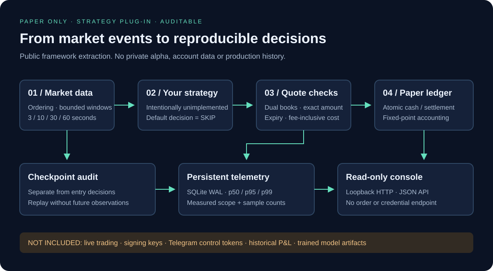
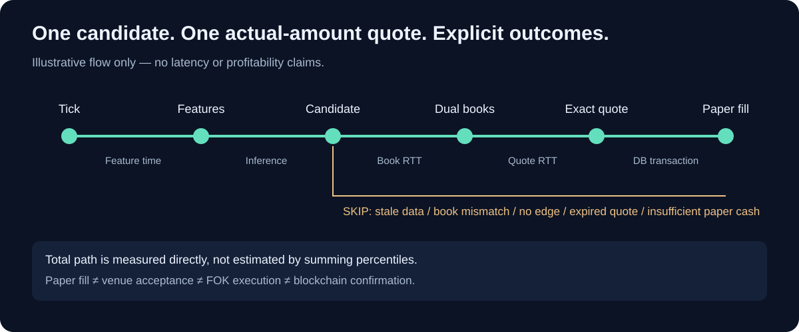
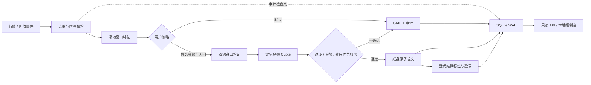

# Prediction Market Research Framework

### 预测市场量化研究框架 · 行情驱动 · 可插拔策略 · 纸盘与延迟审计


**把“行情变化 → 研究决策 → 实际金额报价 → 纸盘记账 → 可追溯评估”连成一条可测试的工程链路。**

本仓库从一个预测市场研究项目中抽取通用工程能力，并重新封装为独立、脱敏的学习框架。原项目中的私有策略、训练参数、账户与服务器配置、真实交易数据及原 Git 历史均未发布。

> 默认运行的是**合成行情 + 空策略 + 纸盘**，没有任何实盘下单入口。该仓库不是完整生产系统的镜像，也不是已验证盈利的交易机器人。没有接入交易所时，演示数据中的耗时和成交不能用于推断真实执行能力。



## 解决什么问题

| 工程问题 | 框架处理方式 |
| --- | --- |
| 浮点误差污染账本 | 价格以十进制字符串输入；资金、费用、份额以 18 位定点 `bigint` 计算与存储 |
| 检查点与入场时机耦合 | 100ms 连续评估；检查点只触发审计快照 |
| 小额报价被放大成大额成交 | 使用计划总支出金额请求一次 Quote；严格复核金额，不做线性放大 |
| “方向正确”与“容易成交”混淆 | 策略扩展与双源盘口 / 报价执行校验分开 |
| 重启后延迟数据消失 | SQLite WAL 持久化分段样本、样本量、测量区间与分位数 |
| 多资产共享资金重复扣款 | 单写入者 + 同步事务，现金扣减与纸盘成交原子提交 |
| 回放读取未来数据 | 按事件时间与接收时间过滤特征；缺失 Quote 不伪造成交 |
| 默认配置误触实盘 | 无签名、转账、下单 API、实盘开关或凭据录入接口 |

## 3 分钟运行

需要 **Node.js 24+** 和 Git。使用 Node 内置 SQLite；部分 Node 版本可能显示 SQLite 实验性提示。没有第三方运行时依赖，不需要 API Key。

```bash
git clone https://github.com/2557806318-boop/prediction-market-research-framework.git
cd prediction-market-research-framework
npm test
npm start
```

浏览器打开 **http://127.0.0.1:8080**。你会看到合成行情处理计数、纸盘现金、最新拒单原因以及持久化延迟表。

- 初始 **100 合成单位**只是公开演示默认值，不是原项目真实本金。
- `STRATEGY_NOT_IMPLEMENTED_OR_SKIPPED` 是预期行为：公开版没有私有交易策略。
- 界面每 2 秒刷新，后台每 100ms 评估；界面刷新速度不等于模型扫描频率。
- 数据自动写入 `data/demo.sqlite`，默认诊断事件保留 24 小时；账本记录不随诊断清理删除。
- `.env.example` 仅作说明；`npm start` 不自动加载它。可使用系统环境变量，或 `node --env-file=.env src/main.mjs`。

```bash
npm run replay           # 确定性合成行情回放，无交易收益声称
npm run security:check   # 发布文件白名单 + 常见秘密模式检测
```

## 执行链路





纸盘仅验证软件链路，不模拟真实订单排队、链上支付、成交竞争或 FOK 成功率。真实预测市场接入需要使用者实现适配器，确认平台规则和区域可用性；本项目不提供绕过限制的能力。

## 策略部分留给你

编辑 [`src/strategy.mjs`](src/strategy.mjs)。默认接口只返回：

```js
export function decide(context) {
  // TODO: 方向概率、风险估计、校准、仓位选择由使用者实现。
  // 不得把盘口深度直接当作方向正确率。
  return { action: 'SKIP', reason: 'STRATEGY_NOT_IMPLEMENTED' };
}
```

实现后，候选返回 `side`、`budgetWei`、`probabilityLower` 和 `minEdge`；这些不是本框架估计出的概率或盈利保证。默认工程演示仓位上限为可用现金的 10%，仅作防误操作限制，不是原策略参数。完整契约见 [扩展指南](docs/EXTENDING.md)。

## 项目结构

```text
src/
  main.mjs             合成行情、100ms 主循环、安全关闭
  market-data.mjs      有界窗口、时间校验、双源盘口
  strategy.mjs         空策略扩展点（唯一默认决策：SKIP）
  adapters.mjs         适配器接口、合成报价、可选公共现货流
  engine.mjs           单次 Quote 流程、超时、纸盘资金限制
  quote.mjs            精确金额、费后成本与有效期校验
  store.mjs            SQLite WAL、共享纸盘、幂等结算、延迟
  money.mjs            定点运算与安全 JSON 序列化
  checkpoints.mjs      一次触发、AUDIT_ONLY
  http-transport.mjs   连接复用、短期 DNS 缓存、HTTPS 分段测量
  rate-limit.mjs       有界等待、可取消的令牌桶
  server.mjs           仅本机可访问的只读接口
web/                    合成数据监控页
examples/               无未来数据的最小回放
tests/                  单元与集成测试
scripts/                发布安全检查
docs/                   架构图、契约、评估、安全说明
```

## 监控接口与计量边界

| 路径 | 内容 |
| --- | --- |
| `/api/status` | 模式、现金、开仓数、合成行情计数、最新决策 |
| `/api/latency` | 最近最多 10,000 条持久化延迟样本的 p50 / p95 / p99 |
| `/api/paper-trades` | 最近 100 笔纸盘记录（金额字符串为定点整数） |
| `/api/events` | 最近 30 条经过字段筛选的审计事件 |

网络 RTT、数据库操作、推理与总路径是不同指标。**不能相加各段 p99 得到总 p99**，也不能把纸盘记账当作平台成交确认。HTTPS agent 的连接里程碑是累计耗时，其最近 500 次请求统计只在进程内；引擎与数据库统计才持久化。详见 [架构与延迟](docs/ARCHITECTURE.md)。

## 研究与安全边界

- [研究评估规范](docs/RESEARCH.md)：按完整回合隔离、逐日 walk-forward、校准与成交选择偏差。
- [公开版内容清单](docs/PUBLICATION.md)：哪些通用能力保留，哪些实现被有意排除。
- [安全说明](SECURITY.md)：凭据、日志、数据库和发布流程。
- 不包含原始历史订单、收益图、生产截图、训练样本或真实账户信息。
- 无自动化策略训练、概率校准器或已训练模型；文档中的研究设计不代表已经实现。
- 不提供投资建议或收益承诺；纸盘结果与实盘存在显著差异。

### 许可

本仓库公开展示，**尚未授予开源使用许可**。公开可见不等于获得复制、修改或商业使用授权；如需使用或再分发，请联系仓库作者。第三方软件与服务分别遵循其自身条款。

---

**English summary:** A sanitized, dependency-free Node.js research scaffold for prediction markets. Includes event windows, exact monetary accounting, quote validation, paper settlement, durable telemetry, replay examples and a local read-only console. Proprietary strategies and production data are intentionally excluded. Synthetic demo only; no live trading implementation.
