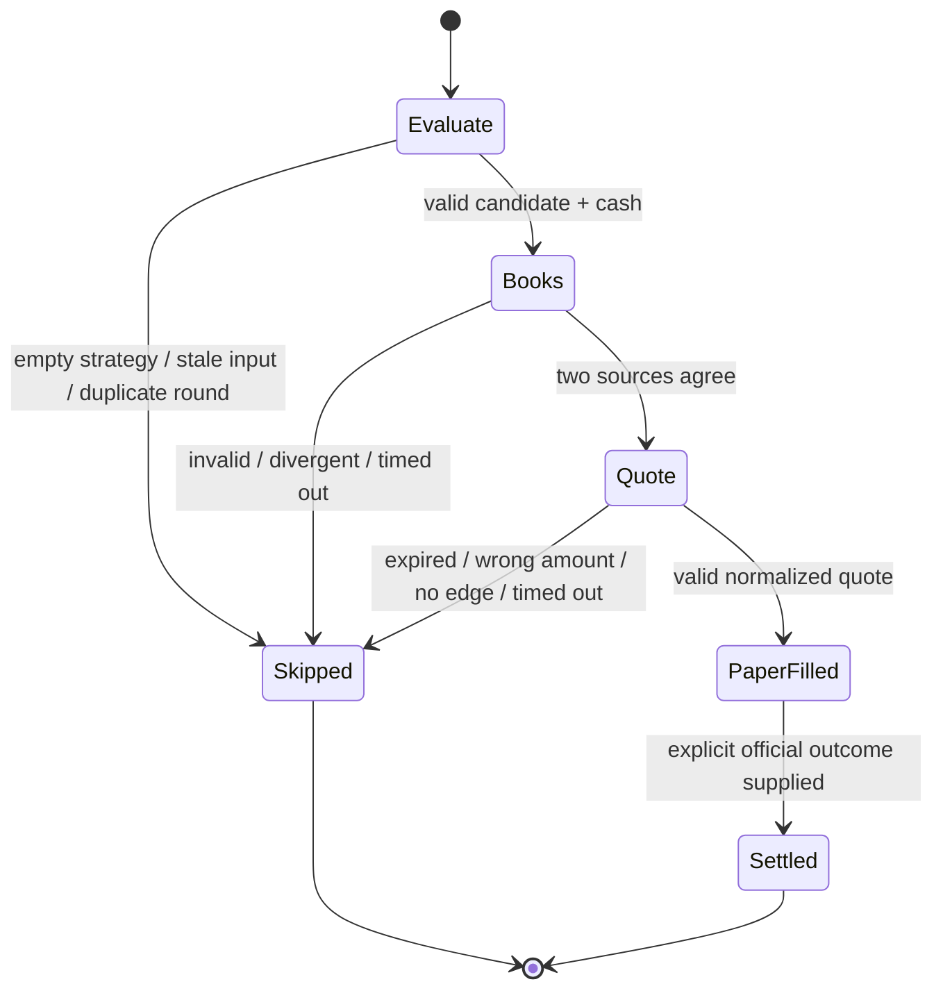

# 架构与延迟口径

## 职责边界

1. **MarketData** 接收标准化事件，维护有界窗口，拒绝重复、乱序、未来时间和非法价格。
2. **Strategy** 只输出候选或跳过，私有算法留空。
3. **PaperEngine** 校验数据年龄、独立盘口、报价金额、成本、有效期及现金，然后提交纸盘。
4. **Store** 是唯一账本写入者。现金更新和成交记录在一个事务中完成，回合键防止重复开仓。
5. **CheckpointScheduler** 与入场无关，只负责审计；错过窗口不会补写伪造快照。
6. **Read API** 仅监听 loopback，没有修改资金或交易模式的接口。

## 状态与失败

超时会中止信号并忽略迟到返回值，不会在超时后继续记账。适配器必须遵守 `AbortSignal`，否则底层请求仍可能消耗网络资源。原始 SDK 错误文本不写日志，避免泄露签名 URL 或请求头；公开版只记录通用错误码，生产诊断应另做脱敏分类。

## 延迟口径

| 指标 | 具体含义 | 持久化 |
| --- | --- | --- |
| `receiveToFeatures` | 演示循环的特征构建耗时，不含真实源传输 | 是 |
| `inference` | 调用策略接口的墙钟耗时 | 是 |
| `officialBookRtt` | 适配器获取双源盘口的整个调用耗时 | 是 |
| `decisionToQuoteDispatch` | 从评估开始到报价请求发出，含前置检查 | 是 |
| `quoteRtt` | 适配器报价调用耗时 | 是 |
| `database.*` | SQLite 同步操作 / 事务的调用耗时 | 是 |
| `pipelineTotal` | 一次评估从开始到返回的直接测量值 | 是 |
| HTTP agent 里程碑 | 从请求开始到 socket / DNS / TCP / TLS / 首字节 | 否，最近 500 个请求 |

SQLite 测量反映调用返回，不等同于物理磁盘 fsync 时延；写入延迟样本自身的成本不包含在被测操作中。`pipelineTotal` 包含正常流程审计，但不包含最后写入其自身样本的时间。延迟表不记录失败操作为零耗时。样本保留区间明确可见。

**p50 / p95 / p99 分别为样本的 50% / 95% / 99% 分位。不同阶段可能重叠，不要直接求和。**

## 数据生命周期

| 表 | 内容 | 默认清理 |
| --- | --- | --- |
| `framework_identity` | 公开演示 schema 标记 | 不清理 |
| `cash` | 当前共享现金 | 不清理 |
| `fills` | 纸盘开仓、结算标签、兑付、已实现盈亏 | 不清理 |
| `events` | 规范化决策、Quote、检查点 | 24 小时 |
| `latency` | 分段耗时样本 | 24 小时 |

为了避免误写生产库，已有非框架表但没有框架标记的 SQLite 文件会被拒绝打开。即使如此，也应使用全新目录，不要复用生产数据库。SQLite 文件可能含你之后接入的真实信息，必须始终排除在版本控制之外。

## 部署边界

此版本是本地研究框架，不提供服务器 IP、SSH 凭据或生产 service 文件。远程使用应通过私有网络或 SSH 转发访问 loopback 接口。若自行暴露 HTTP，必须额外实现认证、TLS、访问控制和日志治理。本仓库默认服务没有为公网暴露设计。
